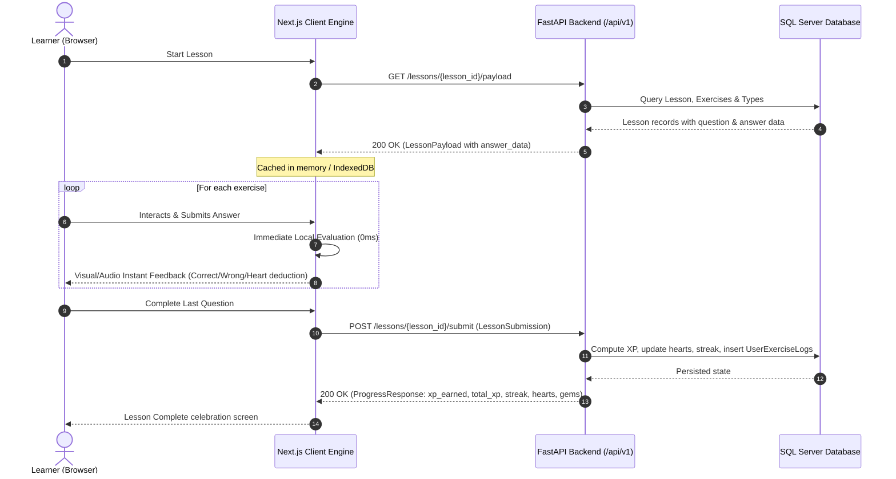

# API Contract Specification

- **Base URL:** `http://localhost:8000/api/v1`
- **Specification Version:** 1.0.0
- **Architectural Style:** RESTful JSON API with Hybrid Client-Side Evaluation

---

## 1. Architectural Overview

### 1.1 Authentication & Session Handling

The API supports two authentication mechanisms:

1. **Bearer JWT Token:** `Authorization: Bearer <jwt_token>` header (primary for programmatic / mobile access).
2. **HTTP-only Cookie:** `access_token` cookie containing `<jwt_token>` (primary for browser / Next.js client).

Role-Based Access Control (RBAC):

- **Public:** Registration, login, health check.
- **Learner (Authenticated):** User profile, active course progression, lesson pre-fetch payloads, lesson completion submissions.
- **Admin (`is_admin = true`):** Full CRUD across users, courses, units, lessons, exercises, and asset management under `/api/v1/admin/*`.

### 1.2 Hybrid Client-Side Evaluation Architecture

Modeled after Duolingo's client engine:

1. **Lesson Pre-Fetch:** When a learner begins a lesson session (`GET /lessons/{lesson_id}/payload`), the backend delivers the complete lesson structure including all exercises with both `question_data` and deterministic `answer_data`.
2. **Zero-Latency Client-Side Evaluation:** The client evaluates deterministic exercises (multiple-choice, word banks, unscrambling, translations) locally in real time with 0ms latency.
3. **Offline & Graceful Degradation:**
   - Pre-fetched lessons run fully offline.
   - Non-deterministic oral exercises (`SPEAK_SENTENCE`) detect `navigator.onLine`; if offline or speech recognition is unsupported, the question is cleanly skipped without penalizing the user's hearts.
4. **Single Consolidated Submission:** After the final question is answered, the client posts one consolidated `LessonSubmission` to `POST /lessons/{lesson_id}/submit`. The backend finalizes XP rewards, streaks, and persists audit logs.



---

## 2. Standard Error Responses

All error payloads follow FastAPI's standard JSON error envelope:

```json
{
  "detail": "Descriptive error message or validation array"
}
```

### HTTP Status Code Reference

| Status Code | Name                  | Description                                                      | Example Payload                                                                                                |
| ----------- | --------------------- | ---------------------------------------------------------------- | -------------------------------------------------------------------------------------------------------------- |
| **400**     | Bad Request           | Logical domain error or invalid query parameter.                 | `{"detail": "Cannot swap unit order with non-existent unit"}`                                                  |
| **401**     | Unauthorized          | Missing or expired JWT credentials.                              | `{"detail": "Could not validate credentials"}`                                                                 |
| **403**     | Forbidden             | Insufficient permissions (e.g., non-admin accessing `/admin/*`). | `{"detail": "Admin access required"}`                                                                          |
| **404**     | Not Found             | Requested entity was not found.                                  | `{"detail": "Lesson not found"}`                                                                               |
| **422**     | Unprocessable Entity  | Pydantic schema or cross-field domain validation failed.         | `{"detail": [{"loc": ["body", "email"], "msg": "value is not a valid email address", "type": "value_error"}]}` |
| **500**     | Internal Server Error | Uncaught server exception or unexpected failure.                 | `{"detail": "Internal server error"}`                                                                          |

---

## 3. Authentication Endpoints (`/auth`)

### 3.1 Register

- **Endpoint:** `POST /api/v1/auth/register`
- **Auth:** Public
- **Status:** `201 Created`

**Request Body (`RegisterRequest`):**

```json
{
  "username": "learner_john",
  "email": "john@example.com",
  "password": "strongPassword123"
}
```

**Response (`TokenResponse`):**

```json
{
  "access_token": "eyJhbGciOiJIUzI1NiIsIn...",
  "token_type": "bearer"
}
```

---

### 3.2 Login

- **Endpoint:** `POST /api/v1/auth/login`
- **Auth:** Public
- **Status:** `200 OK`
- **Cookie Set:** `access_token=<jwt>; HttpOnly; SameSite=Lax; Path=/`

**Request Body (`LoginRequest`):**

```json
{
  "email": "john@example.com",
  "password": "strongPassword123"
}
```

**Response (`TokenResponse`):**

```json
{
  "access_token": "eyJhbGciOiJIUzI1NiIsIn...",
  "token_type": "bearer"
}
```

---

### 3.3 Logout

- **Endpoint:** `POST /api/v1/auth/logout`
- **Auth:** Public
- **Status:** `200 OK`
- **Cookie Cleared:** `access_token=; Max-Age=0; Path=/`

**Response:**

```json
{
  "message": "Successfully logged out"
}
```

---

## 4. User Endpoints (`/users`)

### 4.1 Get Current User Profile

- **Endpoint:** `GET /api/v1/users/me`
- **Auth:** Bearer JWT or Cookie
- **Status:** `200 OK`

**Response (`UserRead`):**

```json
{
  "id": "3fa85f64-5717-4562-b3fc-2c963f66afa6",
  "username": "learner_john",
  "email": "john@example.com",
  "is_admin": false,
  "active_course_id": "1fa85f64-5717-4562-b3fc-2c963f66afa1",
  "cefr_level": "A1",
  "total_xp": 120,
  "hearts": 5,
  "gems": 50,
  "current_streak": 3,
  "last_activity_at": "2026-10-22T08:30:00Z",
  "created_at": "2026-10-01T12:00:00Z"
}
```

---

### 4.2 Update Current User Profile

- **Endpoint:** `PATCH /api/v1/users/me`
- **Auth:** Bearer JWT or Cookie
- **Status:** `200 OK`

**Request Body (`UserUpdate`):**

```json
{
  "username": "john_updated",
  "cefr_level": "A2"
}
```

**Response (`UserRead`):** Updated user object.

---

### 4.3 Get User Progress (Gamification Card)

- **Endpoint:** `GET /api/v1/users/me/progress`
- **Auth:** Bearer JWT or Cookie
- **Status:** `200 OK`

**Response (`UserProgressResponse`):**

```json
{
  "userId": "3fa85f64-5717-4562-b3fc-2c963f66afa6",
  "activeCourse": {
    "id": "1fa85f64-5717-4562-b3fc-2c963f66afa1",
    "title": "Tiếng Anh",
    "imageSrc": "/us_flag.webp"
  },
  "hearts": 5,
  "points": 120,
  "streak": 3
}
```

---

### 4.4 Get User Course Progress

- **Endpoint:** `GET /api/v1/users/me/course-progress`
- **Auth:** Bearer JWT or Cookie
- **Status:** `200 OK`

**Response (`CourseProgressResponse`):**

```json
{
  "activeLesson": {
    "id": "4fa85f64-5717-4562-b3fc-2c963f66afa4",
    "title": "Xin chào & Tạm biệt",
    "order": 1,
    "completed": false,
    "unit": {
      "id": "2fa85f64-5717-4562-b3fc-2c963f66afa2",
      "courseId": "1fa85f64-5717-4562-b3fc-2c963f66afa1",
      "title": "Unit 1: Khởi động",
      "description": "Làm quen với các câu giao tiếp cơ bản",
      "order": 1,
      "lessons": [
        {
          "id": "4fa85f64-5717-4562-b3fc-2c963f66afa4",
          "title": "Xin chào & Tạm biệt",
          "order": 1,
          "completed": false
        }
      ]
    }
  },
  "activeLessonPercentage": 0
}
```

---

## 5. Course Endpoints (`/courses`)

### 5.1 Get My Courses

- **Endpoint:** `GET /api/v1/courses/me`
- **Auth:** Bearer JWT or Cookie
- **Status:** `200 OK`

**Response (`UserCoursesResponse`):**

```json
{
  "activeCourseId": "1fa85f64-5717-4562-b3fc-2c963f66afa1",
  "courses": [
    {
      "id": "1fa85f64-5717-4562-b3fc-2c963f66afa1",
      "title": "Tiếng Anh",
      "imageSrc": "/us_flag.webp"
    }
  ]
}
```

---

### 5.2 Select Active Course

- **Endpoint:** `PATCH /api/v1/courses/select?course_id={course_id}`
- **Auth:** Bearer JWT or Cookie
- **Status:** `200 OK`

**Response:**

```json
{
  "status": "success"
}
```

---

### 5.3 List All Courses

- **Endpoint:** `GET /api/v1/courses`
- **Auth:** Public
- **Status:** `200 OK`

**Response (`list[CourseRead]`):**

```json
[
  {
    "id": "1fa85f64-5717-4562-b3fc-2c963f66afa1",
    "title": "Tiếng Anh",
    "expected_cefr_level": "A1"
  }
]
```

---

### 5.4 Get Active Course Units

- **Endpoint:** `GET /api/v1/courses/active/units`
- **Auth:** Bearer JWT or Cookie
- **Status:** `200 OK`

**Response (`list[UnitSummaryCompat]`):**

```json
[
  {
    "id": "2fa85f64-5717-4562-b3fc-2c963f66afa2",
    "courseId": "1fa85f64-5717-4562-b3fc-2c963f66afa1",
    "title": "Unit 1: Khởi động",
    "description": "Làm quen với các câu giao tiếp cơ bản",
    "order": 1,
    "lessons": [
      {
        "id": "4fa85f64-5717-4562-b3fc-2c963f66afa4",
        "title": "Xin chào & Tạm biệt",
        "order": 1,
        "completed": false
      }
    ]
  }
]
```

---

### 5.5 Get Course Tree Detail

- **Endpoint:** `GET /api/v1/courses/{course_id}`
- **Auth:** Public
- **Status:** `200 OK`

**Response (`CourseWithUnits`):**

```json
{
  "id": "1fa85f64-5717-4562-b3fc-2c963f66afa1",
  "title": "Tiếng Anh",
  "expected_cefr_level": "A1",
  "units": [
    {
      "id": "2fa85f64-5717-4562-b3fc-2c963f66afa2",
      "course_id": "1fa85f64-5717-4562-b3fc-2c963f66afa1",
      "title": "Unit 1: Khởi động",
      "order_index": 1,
      "lessons": [
        {
          "id": "4fa85f64-5717-4562-b3fc-2c963f66afa4",
          "unit_id": "2fa85f64-5717-4562-b3fc-2c963f66afa2",
          "lesson_form_id": "3fa85f64-5717-4562-b3fc-2c963f66afa3",
          "title": "Xin chào & Tạm biệt",
          "order_index": 1
        }
      ]
    }
  ]
}
```

---

## 6. Lesson & Exercise Endpoints (`/lessons`)

### 6.1 Get Active Lesson Payload (Shortcut)

- **Endpoint:** `GET /api/v1/lessons/active/payload`
- **Auth:** Bearer JWT or Cookie
- **Status:** `200 OK`
- **Description:** Resolves the first uncompleted lesson in the user's active course (or the last lesson if all completed) and returns the pre-fetch payload.

**Response (`LessonPayload`):** Same schema as `GET /lessons/{lesson_id}/payload`.

---

### 6.2 Get Lesson Payload (Hybrid Pre-Fetch)

- **Endpoint:** `GET /api/v1/lessons/{lesson_id}/payload`
- **Auth:** Bearer JWT or Cookie
- **Status:** `200 OK`
- **Description:** Returns the lesson metadata and all exercises with both `question_data` and `answer_data` for zero-latency client evaluation and offline resilience.

**Response (`LessonPayload`):**

```json
{
  "id": "4fa85f64-5717-4562-b3fc-2c963f66afa4",
  "unit_id": "2fa85f64-5717-4562-b3fc-2c963f66afa2",
  "lesson_form_id": "3fa85f64-5717-4562-b3fc-2c963f66afa3",
  "title": "Xin chào & Tạm biệt",
  "order_index": 1,
  "exercises": [
    {
      "id": "5fa85f64-5717-4562-b3fc-2c963f66afa5",
      "lesson_id": "4fa85f64-5717-4562-b3fc-2c963f66afa4",
      "type": "COMPLETE_CONVERSATION",
      "question_data": {
        "text": "Can I have some water?",
        "options": [
          { "id": "1", "text": "Yes, here you go." },
          { "id": "2", "text": "I am from Vietnam." }
        ]
      },
      "answer_data": {
        "correct_option_id": "1"
      }
    }
  ]
}
```

---

### 6.3 Get Lesson Exercises (On-Demand)

- **Endpoint:** `GET /api/v1/lessons/{lesson_id}/exercises`
- **Auth:** Bearer JWT or Cookie
- **Status:** `200 OK`
- **Response (`list[ExerciseClient]`):** List of exercise payloads for the lesson.

---

### 6.4 Submit Lesson Completion

- **Endpoint:** `POST /api/v1/lessons/{lesson_id}/submit`
- **Auth:** Bearer JWT or Cookie
- **Status:** `200 OK`
- **Description:** The single final POST sent once the learner completes all questions in a lesson. Backend validates score, computes XP based on tiered accuracy, updates streak, records exercise logs, and updates user stats.

**Request Body (`LessonSubmission`):**

```json
{
  "answers": [
    {
      "exercise_id": "5fa85f64-5717-4562-b3fc-2c963f66afa5",
      "user_answer": "1",
      "is_correct": true,
      "time_spent_ms": 3200
    },
    {
      "exercise_id": "6fa85f64-5717-4562-b3fc-2c963f66afa6",
      "user_answer": "[\"I\", \"like\", \"chicken\"]",
      "is_correct": true,
      "time_spent_ms": 4800
    }
  ],
  "score": 100,
  "hearts_left": 5,
  "started_at": "2026-10-22T10:15:00Z",
  "finished_at": "2026-10-22T10:18:30Z"
}
```

**Response (`ProgressResponse`):**

```json
{
  "xp_earned": 20,
  "total_xp": 140,
  "current_streak": 4,
  "hearts": 5,
  "gems": 50
}
```

#### XP Awarding Rules

| Accuracy Rate | XP Earned |
| ------------- | --------- |
| **100%**      | 20 XP     |
| **80% - 99%** | 15 XP     |
| **50% - 79%** | 10 XP     |
| **< 50%**     | 5 XP      |

---

## 7. The 7 Polymorphic Exercise Types

Every exercise contains:

- `type`: String matching one of the 7 supported discriminators.
- `question_data`: JSON payload for rendering the question (null for audio-only / speech-only).
- `answer_data`: JSON payload containing evaluation criteria.

---

### 7.1 `COMPLETE_CONVERSATION`

Prompts the user with a dialogue text line and a set of selectable textual reply options.

- **`question_data` Schema:**
  - `text` _(string, required)_: Prompt or conversational statement.
  - `options` _(array of OptionText, required, min items: 2)_:
    - `id` _(string, required)_: Unique identifier within options.
    - `text` _(string, required)_: Option label.
- **`answer_data` Schema:**
  - `correct_option_id` _(string, required)_: Must match an `id` in `question_data.options`.
- **Client Evaluation:** `user_answer === answer_data.correct_option_id`.

```json
{
  "type": "COMPLETE_CONVERSATION",
  "question_data": {
    "text": "Can I have some water?",
    "options": [
      { "id": "1", "text": "Yes, here you go." },
      { "id": "2", "text": "I am from Vietnam." }
    ]
  },
  "answer_data": {
    "correct_option_id": "1"
  }
}
```

---

### 7.2 `ARRANGE_WORDS`

Presents a scrambled set of tokens to be arranged into the correct sentence.

- **`question_data` Schema:**
  - `tokens` _(array of string, required, min items: 2)_: Shuffled word bank.
- **`answer_data` Schema:**
  - `correct_sequence` _(array of string, required, min items: 1)_: Ordered words forming the correct answer.
- **Validation Rule:** Every element in `correct_sequence` must exist in `tokens` with frequency ≤ token frequency.
- **Client Evaluation:** `JSON.stringify(user_tokens) === JSON.stringify(answer_data.correct_sequence)`.

```json
{
  "type": "ARRANGE_WORDS",
  "question_data": {
    "tokens": ["chicken", "I", "like"]
  },
  "answer_data": {
    "correct_sequence": ["I", "like", "chicken"]
  }
}
```

---

### 7.3 `COMPLETE_TRANSLATION`

Presents a source sentence and a translated text template containing positional blanks `{0}`, `{1}`, etc.

- **`question_data` Schema:**
  - `source_sentence` _(string, required)_: Original sentence to translate.
  - `text_template` _(string, required)_: Target template with indexed placeholders (e.g. `"{0}"` or `"I {0} an {1}."`).
- **`answer_data` Schema:**
  - `correct_words` _(array of string, required)_: Expected strings filling `{0}`, `{1}` in order.
- **Validation Rule:** `length(correct_words) === count_of_unique_placeholders(text_template)`.
- **Client Evaluation:** Normalized case-insensitive, trimmed comparison per blank index.

```json
{
  "type": "COMPLETE_TRANSLATION",
  "question_data": {
    "source_sentence": "Chào buổi chiều",
    "text_template": "{0}"
  },
  "answer_data": {
    "correct_words": ["Good afternoon"]
  }
}
```

---

### 7.4 `PICTURE_MATCH`

Displays a target word and image-backed answer options.

- **`question_data` Schema:**
  - `word` _(string, required)_: Target word or phrase to match.
  - `options` _(array of OptionImage, required, min items: 2)_:
    - `id` _(string, required)_: Unique identifier.
    - `text` _(string, required)_: Option label text.
    - `image_url` _(string, required)_: Path starting with `images/`, `/static/images/`, `http://`, `https://`, or `/media/`.
- **`answer_data` Schema:**
  - `correct_option_id` _(string, required)_: Must match an `id` in `question_data.options`.
- **Client Evaluation:** `user_answer === answer_data.correct_option_id`.

```json
{
  "type": "PICTURE_MATCH",
  "question_data": {
    "word": "Coffee",
    "options": [
      { "id": "1", "text": "Cà phê", "image_url": "images/coffee.jpg" },
      { "id": "2", "text": "Trà", "image_url": "images/tea.jpg" }
    ]
  },
  "answer_data": {
    "correct_option_id": "1"
  }
}
```

---

### 7.5 `TYPE_HEAR`

Plays audio using TTS (or audio asset) and requires the user to type the transcription.

- **`question_data` Schema:** Must be `null`.
- **`answer_data` Schema:**
  - `correct_transcription` _(string, required)_: Target transcription. Also serves as the client's Web Speech API TTS source text.
- **Client Evaluation:** Normalized comparison ignoring punctuation, extra whitespace, and casing:
  `normalize(user_input) === normalize(answer_data.correct_transcription)`.

```json
{
  "type": "TYPE_HEAR",
  "question_data": null,
  "answer_data": {
    "correct_transcription": "Nice to meet you."
  }
}
```

---

### 7.6 `LISTEN_FILL`

Plays an audio sentence and provides an interactive word bank for selecting tokens in order.

- **`question_data` Schema:**
  - `text` _(string, required)_: Full sentence used for audio playback.
  - `word_bank` _(array of WordBankItem, required, min items: 2)_:
    - `id` _(string, required)_: Unique identifier.
    - `text` _(string, required)_: Word label.
- **`answer_data` Schema:**
  - `correct_sequence_ids` _(array of string, required, min items: 1)_: Ordered list of word IDs.
- **Validation Rule:** All IDs in `correct_sequence_ids` must exist in `question_data.word_bank`.
- **Client Evaluation:** `JSON.stringify(user_selected_ids) === JSON.stringify(answer_data.correct_sequence_ids)`.

```json
{
  "type": "LISTEN_FILL",
  "question_data": {
    "text": "apple juice please",
    "word_bank": [
      { "id": "1", "text": "apple" },
      { "id": "2", "text": "juice" },
      { "id": "3", "text": "please" },
      { "id": "4", "text": "car" }
    ]
  },
  "answer_data": {
    "correct_sequence_ids": ["1", "2", "3"]
  }
}
```

---

### 7.7 `SPEAK_SENTENCE`

Prompts the learner to speak the sentence using Speech-to-Text (STT) via the browser's Web Speech API.

- **`question_data` Schema:** Must be `null`.
- **`answer_data` Schema:**
  - `expected_text` _(string, required)_: Target speech sentence displayed on the card and compared against STT transcript.
- **Client Evaluation & Graceful Degradation:**
  - Checks `navigator.onLine`. If offline or SpeechRecognition is unavailable, automatically skips without heart deduction.
  - Compares spoken transcript against `expected_text` (at least 50% keyword match or lenient threshold).
  - Permits up to 2 retry attempts ("Try again") before moving forward.

```json
{
  "type": "SPEAK_SENTENCE",
  "question_data": null,
  "answer_data": {
    "expected_text": "Hello, how are you?"
  }
}
```

---

## 8. Admin Endpoints (`/admin/*`)

All `/admin/*` endpoints strictly require an authenticated user with `is_admin = true`. Unauthorized requests receive `403 Forbidden` (`{"detail": "Admin access required"}`).

### 8.1 Users Management (`/admin/users`)

| Method   | Endpoint                 | Description                                  | Request Body      | Response Body         |
| -------- | ------------------------ | -------------------------------------------- | ----------------- | --------------------- |
| `GET`    | `/admin/users`           | List users (paginated: `skip`, `limit`)      | None              | `list[AdminUserRead]` |
| `GET`    | `/admin/users/{user_id}` | Get user by UUID                             | None              | `AdminUserRead`       |
| `PATCH`  | `/admin/users/{user_id}` | Update user fields (role elevation disabled) | `AdminUserUpdate` | `AdminUserRead`       |
| `DELETE` | `/admin/users/{user_id}` | Delete user                                  | None              | `204 No Content`      |

---

### 8.2 Courses Management (`/admin/courses`)

| Method   | Endpoint                     | Description                               | Request Body   | Response Body                     |
| -------- | ---------------------------- | ----------------------------------------- | -------------- | --------------------------------- |
| `GET`    | `/admin/courses`             | List courses (paginated: `skip`, `limit`) | None           | `list[CourseReadAdmin]`           |
| `POST`   | `/admin/courses`             | Create new course                         | `CourseCreate` | `201 Created` (`CourseReadAdmin`) |
| `GET`    | `/admin/courses/{course_id}` | Get course detail                         | None           | `CourseReadAdmin`                 |
| `PATCH`  | `/admin/courses/{course_id}` | Update course                             | `CourseUpdate` | `CourseReadAdmin`                 |
| `DELETE` | `/admin/courses/{course_id}` | Delete course                             | None           | `204 No Content`                  |

---

### 8.3 Units Management (`/admin/units`)

| Method   | Endpoint                  | Description                                     | Request Body                    | Response Body                   |
| -------- | ------------------------- | ----------------------------------------------- | ------------------------------- | ------------------------------- |
| `GET`    | `/admin/units`            | List units (optional query: `course_id`)        | None                            | `list[UnitReadAdmin]`           |
| `POST`   | `/admin/units`            | Create new unit                                 | `UnitCreate`                    | `201 Created` (`UnitReadAdmin`) |
| `GET`    | `/admin/units/{unit_id}`  | Get unit detail                                 | None                            | `UnitReadAdmin`                 |
| `PATCH`  | `/admin/units/{unit_id}`  | Update unit                                     | `UnitUpdate`                    | `UnitReadAdmin`                 |
| `DELETE` | `/admin/units/{unit_id}`  | Delete unit                                     | None                            | `204 No Content`                |
| `POST`   | `/admin/units/swap-order` | Atomically swap `order_index` between two units | `id_a: UUID, id_b: UUID` (Body) | `list[UnitReadAdmin]` (size 2)  |

---

### 8.4 Lessons Management (`/admin/lessons`)

| Method   | Endpoint                     | Description                                       | Request Body                    | Response Body                     |
| -------- | ---------------------------- | ------------------------------------------------- | ------------------------------- | --------------------------------- |
| `GET`    | `/admin/lessons`             | List lessons (optional query: `unit_id`)          | None                            | `list[LessonReadAdmin]`           |
| `POST`   | `/admin/lessons`             | Create new lesson                                 | `LessonCreate`                  | `201 Created` (`LessonReadAdmin`) |
| `GET`    | `/admin/lessons/{lesson_id}` | Get lesson detail                                 | None                            | `LessonReadAdmin`                 |
| `PATCH`  | `/admin/lessons/{lesson_id}` | Update lesson                                     | `LessonUpdate`                  | `LessonReadAdmin`                 |
| `DELETE` | `/admin/lessons/{lesson_id}` | Delete lesson                                     | None                            | `204 No Content`                  |
| `POST`   | `/admin/lessons/swap-order`  | Atomically swap `order_index` between two lessons | `id_a: UUID, id_b: UUID` (Body) | `list[LessonReadAdmin]` (size 2)  |

---

### 8.5 Exercises Management (`/admin/exercises`)

| Method   | Endpoint                                      | Description                                              | Request Body                    | Response Body                                                     |
| -------- | --------------------------------------------- | -------------------------------------------------------- | ------------------------------- | ----------------------------------------------------------------- |
| `GET`    | `/admin/exercises`                            | List exercises (optional query: `lesson_id`)             | None                            | `list[ExerciseReadAdmin]`                                         |
| `POST`   | `/admin/exercises`                            | Create exercise with payload validation                  | `ExerciseCreate`                | `201 Created` (`ExerciseReadAdmin`)                               |
| `GET`    | `/admin/exercises/{exercise_id}`              | Get exercise detail                                      | None                            | `ExerciseReadAdmin`                                               |
| `PATCH`  | `/admin/exercises/{exercise_id}`              | Update exercise with cross-field validation              | `ExerciseUpdate`                | `ExerciseReadAdmin`                                               |
| `DELETE` | `/admin/exercises/{exercise_id}`              | Delete exercise & cascade clean exercise logs            | None                            | `204 No Content`                                                  |
| `GET`    | `/admin/exercises/{exercise_id}/dependencies` | Count dependent `UserExerciseLogs` before deletion       | None                            | `ExerciseDependencySummary`                                       |
| `POST`   | `/admin/exercises/swap-order`                 | Atomically swap `order_index` between two exercises      | `id_a: UUID, id_b: UUID` (Body) | `list[ExerciseReadAdmin]` (size 2)                                |
| `GET`    | `/admin/exercises/{exercise_id}/logs`         | Most frequent mistaken user answers                      | None                            | `list[MistakeAnalytics]`                                          |
| `POST`   | `/admin/exercises/upload-image`               | Upload image for `PICTURE_MATCH` (`multipart/form-data`) | `file: UploadFile`              | `{"image_url": "images/...", "static_url": "/static/images/..."}` |
| `DELETE` | `/admin/exercises/delete-image`               | Remove image from static directory                       | `image_url: string` (Query)     | `204 No Content`                                                  |

---

### 8.6 Exercise Types Lookup (`/admin/exercise-types`)

| Method | Endpoint                | Description                                 | Request Body | Response Body                 |
| ------ | ----------------------- | ------------------------------------------- | ------------ | ----------------------------- |
| `GET`  | `/admin/exercise-types` | List available exercise types (UUID & name) | None         | `list[ExerciseTypeReadAdmin]` |

---

## 9. Synchronization & Integrity Guarantee

To ensure zero drift between layers:

1. Every Pydantic model in `server/app/schemas/` corresponds to a matching TypeScript interface in `client/types/api.ts`.
2. Property names for compatibility endpoints match JSON field keys exactly (e.g. `userId`, `activeCourse`, `imageSrc`).
3. Core domain entity endpoints use canonical snake_case (e.g. `lesson_id`, `question_data`, `answer_data`, `order_index`).
4. Automated formatting checks (`ruff` for Python, `prettier` for TypeScript and Markdown) run as standard gates to enforce codebase cleanliness.
